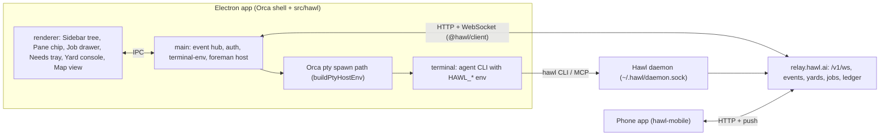

# Hawl Workstation: ARCHITECTURE

Status 2026-10-19 (round 2): design only. Nothing in `src/hawl/` exists yet. Every claim about Orca's code is tagged with `file:line` read on branch `hawl/P4-docs` (base `hawl/main` 3fd6f54a4, Orca upstream `20fc7af55`). A claim tagged **(unverified)** was not confirmed in code. Claims about the Hawl relay come from `m2-contract.md` (a contract, not shipped code) and are tagged **(contract)**.

Sources: `PROJECT.md`, the plan (`i-want-to-sort-goofy-treasure.md`), the m2 contract (`E:\hawl-platform\_work\2026-10-18-scenarios\m2-contract.md`, S4 to S50). The per-line plan is in `SPEC-MAP.md`.

## 1. Shape of the fork

Thin fork of Orca (MIT, stablyai/orca), credited openly. Orca stays the shell: Electron main process, React renderer (Zustand store), node-pty terminals, git worktrees, the loopback agent-hook server, the plugin host, the mobile companion and its relay client.

Rules:
- All Hawl code lives in `src/hawl/` (main, renderer, shared), `hawl-mobile/` and `hawl-plugin/`.
- Edits to Orca files are small hooks. Each hook is one row in [FORK-HOOKS.md](FORK-HOOKS.md) (file, literal anchor text, edit, milestone, status). `hawl-tools/check-docs.mjs` fails if an anchor or a cited file is missing.
- Hawl never edits relay or CLI files that belong to the m2 builders. The workstation codes to the contract schemas (`packages/gateway-contract`, `packages/protocol` in the hawl-platform repo).

## 2. Layout and component map

```
src/hawl/
  shared/      types and zod schemas for relay payloads (site, yard, station, job, card, ledger, menu, approval)
  client/      @hawl/client: relay HTTP + WebSocket client, auth, token storage, reconnect, event replay
  main/        main-process services: auth, per-terminal Hawl env, event hub, foreman host, daemon bridge, IPC handlers
  renderer/    React screens, one folder per screen in the table below
  theme/       Hawl tokens (from packages/ui/tokens.css), icons, art
hawl-plugin/   Orca plugin (orca-plugin.json) for panels that fit the plugin host; see section 8
hawl-mobile/   Hawl-native phone app (starts from Orca's mobile/ Expo app); see section 10
hawl-tools/    doc checks (check-docs.mjs); not shipped in the app
hawl-docs/     images used by the documents (design art, later real screenshots)
```

`src/hawl/` is new code, so the lint ratchets that scan `git ls-files` (`package.json` `lint` script) need exemptions in one config commit (FORK-HOOKS row 10). Which ratchets fire on new files is not yet checked: **(unverified)**.

### The screens (one list, used by SPEC-MAP.md)

SPEC-MAP.md uses exactly these names in its "Screen" column. A name that is not in this table is a defect in one of the two documents.

| Screen (name in SPEC-MAP) | Folder under `src/hawl/renderer/` | What it is | Where it mounts in Orca | Milestone |
|---|---|---|---|---|
| Sidebar tree | `sidebar/` | Site switcher, "<Name>'s yard" header, station rows (project folders), agent rows with work-card title | Above `<WorktreeList` in `components/sidebar/index.tsx` (FORK-HOOKS 3) | M2 |
| Pane chip | `pane/` | Chip and live strip in each terminal's header: site, agent handle, state, card title, claim and lease, refusal and blocked notices | Inside `TerminalPaneHeaderOverlay.tsx` (FORK-HOOKS 2) | M3 |
| Job drawer | `jobs/` (drawer) | Per-job panel: hops, why routed, reroute and decline, claim history, artifacts, receipt, inspector, send-back count | Opens from the Needs tray, the Yard console ledger and the Sidebar tree; Hawl-owned overlay, no Orca hook beyond store (FORK-HOOKS 5) | M4 |
| New job form | `jobs/` (form) | Open a job: capability or free text, done-means, files, links, inspection capability, sign-off; duplicate hint and classifier suggestion | Hawl-owned dialog launched from the Sidebar tree and Yard console | M4 |
| Needs tray | `needs/` | Everything waiting on this person: approvals, agent questions (`ask_human`), held-offline jobs, direct-line requests, send-back stops | Hawl-owned panel, opened from the Sidebar tree header badge | M4 |
| Messages | `messages/` | Conversations and rooms in this person's yard, DM composer | Hawl-owned panel, opened from the Sidebar tree | M5 |
| Yard console | `yard/` | Tabs: Menu, Foreman, Ledger, Team check, Doctor, Sites (card fields), Setup interview | Hawl-owned panel, opened from the Sidebar tree yard header | M5 |
| Settings | `settings/` | Site yard rule (owner only), notification kinds, digest hour | Hawl section added to the app's settings (decide in M2 whether by hook or as a separate Hawl panel) | M5 |
| Map view | `map/` | Dispatcher hub, factories, crates; plain list mode | Hawl-owned panel, opened from the Sidebar tree | M5 |
| Phone app | `hawl-mobile/` | Needs tray, job receipts, ask answers, list view on a phone | Separate Expo app | M6 |

Non-screen parts: `client/` and `main/event-hub.ts` (M1), `main/terminal-env.ts` (M3, section 4), `main/foreman/` (section 9, M5).

### How the parts connect



## 3. Shell (what Orca already is)

| Part | Where | Verified |
|---|---|---|
| Main entry | `electron.vite.config.ts`; built to `out/main/index.js` (`package.json` `main`) | yes |
| Window title and frame | `src/main/window/createMainWindow.ts:108` (`title: opts?.title ?? 'Orca'`) | yes |
| App id, product name, protocol, update feed | `config/electron-builder.config.cjs:112` (`appId`), `:242` (`productName`), `:243` (`protocols`), `:802-805` (`publish` github owner/repo) | yes |
| Theme tokens | `src/renderer/src/assets/main.css:197` (`--background` light), `:298` (`.dark`), font at `:13` (Geist) | yes |
| Terminal palettes | `src/shared/terminal-themes/` | dir exists; contents not read |
| Telemetry | `src/main/telemetry/client.ts:31` (write key only from build-time define), `:111` (`host: 'https://us.i.posthog.com'`). The file comment at `:182-183` says contributor and non-official builds do not transmit | yes (comment); network capture is the M0 proof |
| Data model | `src/shared/repo-types.ts:53` (`Repo`), `src/shared/worktree/types.ts:100` (`Worktree`), `src/shared/project-group-types.ts:1` (`ProjectGroup`) | yes |
| Store | `src/renderer/src/store/slices/` (one slice per concern, e.g. `agent-status.ts`) | yes |
| Dev userData | `config/scripts/run-electron-vite-dev.mjs:434-451`: `pnpm dev` uses `%APPDATA%\orca-dev`, override with `ORCA_DEV_USER_DATA_PATH` | yes |

## 4. Seam: Hawl env into every terminal

One terminal = one agent in the owner's yard (plan, "Yard-native projects"). The Hawl CLI picks which of the folder's workers it acts as in `packages/cli/src/resolve.ts` (hawl-platform, read 2026-10-19): `HAWL_RESIDENT_ID` first, but only if that id is one of the folder's registered workers (`resolve.ts:91-98`: "An id that is not one of this folder's workers is ignored, not trusted"); then `HAWL_SITE` (`:102-110`); then the folder's id file; then the single or first worker.

### Orca spawn path (read in this pass)

1. Renderer calls IPC `pty:spawn`. Handler: `src/main/ipc/pty/ipc/spawn.ts:10-19`.
2. Pane identity is stamped first, by `stampPtySpawnPaneEnv` (`src/main/ipc/pty/spawn-pane-env.ts:41`; sets `ORCA_PANE_KEY` `:57`, `ORCA_WORKTREE_ID` `:64`). Call sites: `src/main/ipc/pty/ipc/spawn-env.ts:102` (IPC lane) and `src/main/ipc/pty/runtime/spawn-preflight.ts:118` (runtime lane).
3. Then the host env is built by `buildPtyHostEnv` (`src/main/ipc/pty/host-env/assembly.ts:44`, mutates `baseEnv` in place, returns it at `:322`). It has exactly two call sites:
   - `src/main/ipc/pty/spawn-host-env.ts:214`, reached from `resolvePtySpawnHostEnv`. From the IPC lane: `spawn-env.ts:102` stamps, then `spawn-env-codex.ts:13` calls `resolvePtySpawnHostEnv`. From the runtime lane: `spawn-preflight.ts:118` stamps, then `:125` calls it. In both, the stamp runs before `buildPtyHostEnv` (read in code, not run).
   - `src/main/ipc/pty/provider/local-configure.ts:79`, the `LocalPtyProvider` `buildSpawnEnv` callback. `local-pty-spawn-environment.ts:29-40` spreads `spawn.env` (which carries the stamped `ORCA_PANE_KEY`) into the env and keeps pane keys that the caller named explicitly (`removeUnspecifiedPaneIdentityEnv`), then calls `buildSpawnEnv` at `:68`. Same order; the `spawn.env` object being the stamped one is inferred from those lines, not run.
4. `buildPtyHostEnv`'s doc comment (`assembly.ts:38-41`) says it must not be called for SSH (`args.connectionId` set).

So at the end of `buildPtyHostEnv`, `baseEnv.ORCA_PANE_KEY` and `baseEnv.ORCA_WORKTREE_ID` are already set for both call sites. The Hawl hook needs no extra argument: it reads them from `baseEnv`.

### Hook coordinates are conditional

`assembly.ts:128-132` first deletes inherited `ORCA_AGENT_HOOK_*` keys (list in `host-env/spawn-env-keys.ts:4-12`), and then `Object.assign(baseEnv, agentHookServer.buildPtyEnv())` runs only `if (opts.agentStatusHooksEnabled)`. `buildPtyEnv` (`src/main/agent-hooks/server/server-runtime-env.ts:13-22`) itself returns `{}` when `statusHooksEnabled` is false, the port is not yet above 0, or there is no token. So the hook port and token reach a terminal at spawn only when agent status hooks are enabled in settings and the loopback server is already listening. Hawl needs those hooks on (the Pane chip's agent state depends on them), so the workstation turns them on by default and the M3 proof starts a terminal immediately after launch to check the server is ready in time. Whether the default is on today for new installs: **(unverified)**.

### What the Hawl hook sets

Hook (FORK-HOOKS row 1): `applyHawlTerminalEnv(id, baseEnv, opts)` from `src/hawl/main/terminal-env.ts`, called last in `buildPtyHostEnv`. It always writes or deletes these keys so nothing inherited from Orca's own process leaks into a terminal:

| Key | Value | Source |
|---|---|---|
| `HAWL_SITE` | slug of the site active in the Sidebar tree | workstation state |
| `HAWL_PANE_KEY` | copy of `baseEnv.ORCA_PANE_KEY` | the stamp above |
| `HAWL_RESIDENT_ID` | the folder worker for this terminal's agent, or deleted | see below |

`HAWL_RESIDENT_ID` cannot be minted at spawn: the CLI ignores an id that is not a registered worker of the folder (`resolve.ts:91-98`). So the rule is:
1. Find the folder for the pane: `baseEnv.ORCA_WORKTREE_ID` names the worktree; the workstation main process maps it to its path. How that lookup is done in main (store is renderer-side) is **(unverified)**; `opts` carries no cwd.
2. Read that folder's registered workers (the town file the CLI reads, `resolve.ts` top of the function; reading it from the main process is not yet designed).
3. Pick the worker whose `platform` matches `opts.launchAgent` (a field of `BuildPtyHostEnvOptions`, used at `assembly.ts` for `launchAgent === 'claude'`). Exactly one match: set `HAWL_RESIDENT_ID` to it. Zero or several: delete the key; the CLI then falls back to `HAWL_SITE` and platform, and for several the CLI itself marks the route `ambiguous`.
4. A terminal started before its agent ever joined the folder has no worker yet. It runs with `HAWL_SITE` only. When the agent registers (first `hawl` call), the workstation learns the worker from the relay event and shows it on the Pane chip by `HAWL_PANE_KEY`; the running shell keeps its old env, which is why the CLI also falls back to the folder id file. Binding a pane to a worker after the fact needs the CLI to send `HAWL_PANE_KEY` when it registers: that is a change in the peer-owned CLI (piece P2) and is not designed or agreed **(open)**.

Limits found:
- SSH terminals skip `buildPtyHostEnv`, so Hawl env does not reach them by this seam. How Hawl works over SSH is not designed **(unverified)**.
- The daemon lane (`src/main/daemon/pty-subprocess/spawn-environment.ts`) builds the child env from the daemon's own `process.env` plus the explicit `opts.env` (`:174-192`), then removes only a fixed set of pane identity keys when the caller did not pass them (`:33-42`, `:99-107`, called at `:192`: `ORCA_PANE_KEY`, `ORCA_TAB_ID`, `ORCA_WORKTREE_ID`, `ORCA_AGENT_LAUNCH_TOKEN`, ...). `HAWL_*` is not in that list, so `HAWL_*` passed in `opts.env` survives. Because the daemon inherits its own `process.env`, the workstation must never export `HAWL_*` into Orca's own process env, or every terminal inherits it; the hook's always-write-or-delete rule covers the case. Read in code; the M3 proof is a terminal through the daemon that prints its env.
- Structured-session agents (`src/main/runtime/structured-session-child-env.ts`) do not call `buildPtyHostEnv`; whether they need the hook is not checked.

## 5. Seam: terminal pane header (foreman strip and state)

- Header component: `src/renderer/src/components/terminal-pane/TerminalPaneHeaderOverlay.tsx:64` (default export, props at `:64-102` include `tabId`, `worktreeId`, `panes`, `paneTitles`). It is mounted at `src/renderer/src/components/terminal-pane/TerminalPaneSurface.tsx:338`.
- Tab: `src/renderer/src/components/tab-bar/TerminalSortableTab.tsx:8` (wraps `SortableTab` with `useTabAgent`).
- Hawl hook: render `<HawlPaneChip paneKey=... />` from `src/hawl/renderer/` inside the header overlay. One import and one JSX line in `TerminalPaneHeaderOverlay.tsx`. The chip shows site, agent handle, state, work card title, claim/lease (S16, S17, S23, S24). Live events appear in a strip in the pane chrome, never typed into the pty text (plan).
- Agent state already available to the renderer: store slice `src/renderer/src/store/slices/agent-status.ts` and the event schema `src/shared/plugins/plugin-events.ts:28-48` (`agent.status.changed`: `worktreeId`, `paneKey`, `state`, `mainAgent`). The Hawl chip joins on `paneKey`.
- Agent status transport: managed hooks POST to the loopback hook server, OSC 7501 fills gaps; hooks win (`src/main/agent-hooks/README.md:3-20`). Claude hooks are installed as managed entries in Claude's `settings.json` by `src/main/claude/hook-service.ts:167,187` (`install` -> `applyManagedHooks`). Hawl's own Claude hook entries must stay distinct from Orca's managed ones; the managed marker logic is `applyManagedHooks` (`claude-managed-hook-events.ts`, not read in full **(unverified)**).
- `src/main/agent-awake-service.ts:45` (`AgentAwakeService`) manages computer awake mode (power-save blocker, `:30-43`). It is not the Hawl wake mechanism (plan).

## 6. Seam: sidebar

- Sidebar root: `src/renderer/src/components/sidebar/index.tsx`. Children in order: `<SidebarNav />` (`:174`), `<SidebarHeader ...>` (`:175`), `<WorktreeList ...>` (`:199`). `SidebarAgentsList` is lazy (`:27`).
- Plan: site switcher above the tree, then "<Name>'s yard", then each project folder as a station, then its terminals/agents (S4, S5). Orca's tree is Repo -> Worktree (`Repo` `repo-types.ts:53`, `Worktree` `worktree/types.ts:100`). A Hawl station maps to an Orca `Repo` folder; a terminal/agent maps to a pane inside a `Worktree`.
- The sidebar has two bodies: `SidebarAgentsList` (when `sidebarBody === 'agents'`) and the worktree list (`:184` and `:199`, read). Hawl hooks the worktree body first.
- Hawl hook (FORK-HOOKS 3): render `<HawlSidebarTree />` (site switcher and yard header) above `<WorktreeList>` and let `WorktreeList` row components accept a Hawl decoration slot. Exact insertion points are decided in M2; nothing about `WorktreeList` internals was read **(unverified)**.

## 7. Seam: relay events, mapping, state

The workstation is its own relay client (plan, "Terminal seams"):
- `@hawl/client` (in `src/hawl/client/`) opens `/v1/ws` and `/v1/towns/:twn/events` on `relay.hawl.ai` (routes per plan and contract; `/v1/ws` and the events route exist in the hawl-platform relay per the plan; contract routes for yards, ledger, jobs, asks, approvals are **(contract)** and not on origin/main as of 2026-10-19 per the plan).
- Auth: device-code login at hawl.ai/device, then an EdDSA assertion to `POST /v1/auth/token` (plan; from `packages/cli/src/commands/join.ts`). Token goes to the OS keyring (M1). Orca has its own profile cloud sign-in (`src/main/orca-profiles/profile-cloud-*.ts`, e.g. `profile-cloud-service.ts`, `profile-cloud-pkce.ts`); its backend host was not read **(unverified)**, and Hawl sign-in replaces or sits beside it (decide in M1).
- The Hawl daemon (`~/.hawl/daemon.sock`, token in `~/.hawl/daemon.token`) is request/response with no event subscription (plan). The workstation uses it for local state, mailbox and tool calls, not for live events.
- Event hub: `src/hawl/main/event-hub.ts` fans relay events to renderer windows over one IPC channel and to the foreman host. Renderer state lives in a new Zustand slice `src/hawl/renderer/store/hawl-slice.ts`, registered in the app store with one hook line.

## 8. Plugin host

Orca has an out-of-process plugin host (`src/main/plugins/`, `src/shared/plugins/`).
- Manifest (zod): `src/shared/plugins/plugin-manifest.ts:96-121` (`contributes.panels|commands|events|languagePacks|keybindings|vmRecipes|agents`, `capabilities`, `pluginApi: 1`). File name `orca-plugin.json` (from the plan; the manifest-file reader `src/main/plugins/plugin-manifest-file.ts` was not opened **(unverified)**).
- Panels render in a sandboxed iframe in the right-sidebar activity bar only (`plugin-manifest.ts:44-51`; renderer `components/right-sidebar/PluginPanel.tsx`).
- Events a plugin can subscribe to: `worktree.created`, `worktree.removed`, `agent.status.changed` (`plugin-events.ts:50-54`, payload schemas).
- Experimental, no stability promise: `src/shared/plugins/plugin-host-api.ts` header (read).
- Official-publisher gate: `src/shared/plugins/plugin-marketplace.ts:9-12` (`OFFICIAL_PLUGIN_PUBLISHER = 'stablyai'`, id prefix `orca-`, marketplace repo `stablyai/orca-plugins`). Bundled plugins must pass that gate, so the fork changes these constants or loads `hawl-plugin/` as a dev/local plugin. Choice made in M2.

Use: `hawl-plugin/` holds only what fits a right-sidebar panel (for example ledger list, doctor output). The tree, pane header, job drawer and yard console are native `src/hawl/renderer/` code, because panels cannot draw in the sidebar tree or terminal header.

## 9. Foreman

Decision (Aaron 2026-10-19, `PROJECT.md`): the foreman is a registered agent. The yard owner registers one of their own agents as the foreman (a role on an agent, not a separate service). The Workstation alerts when a yard has no foreman or its foreman is offline, and guides setup: pick an agent, confirm menu and hold times, test with the team check (S43), and `hawl doctor` (S44) names "no foreman" or "foreman offline". The relay answering service (accept and queue per the published menu when the foreman is offline, S15) is a relay piece owned by the m2 builders, not by this fork.

Workstation parts, in `src/hawl/main/foreman/` and `src/hawl/renderer/yard/`:
- Foreman registration: pick agent, set role, show state "no foreman / offline / online".
- Menu editor and publish (S11, S12), hold and release times (S18), auto-accept (S15), foreman rules (S20).
- Intake and routing to inner agents of the yard follow the contract's job states: queued, offered, running, held (**contract**, section 4 "Foreman design"). In this design the registered agent executes the loop; the workstation supplies the UI, the registration, and the alerts. Whether the loop logic ships as a Hawl skill/MCP tool or as workstation main-process code is the P3-foreman piece's decision; this document does not decide it.

## 10. Phone

- Orca's phone path (read): Expo app in `mobile/` (`mobile/README.md`), desktop WebSocket RPC server on port 6768 (`mobile/README.md:7`; server code `src/main/runtime/rpc/ws-transport.ts:1-3`), cloud relay client `src/main/runtime/mobile-cloud-relay/` (`desktop-relay-service.ts:45`), cloud relay and push services in `cloud/apps/{push,relay,relay-fence-broker,relay-ops}` (GCP-specific per the plan).
- Hawl phone (M6): `hawl-mobile/` starts from `mobile/`, replaces the pairing relay and push with Hawl's relay and Hawl's own push. Approvals and ask_human answers (S39, S40) go to the phone through Hawl's relay, not through Orca's cloud. Mobile distribution and signing are open (`PROJECT.md`).

## 11. Visualizations (map, list)

Map (S45 to S47): the Dispatcher hub, factories, crates. Designs and art come from `E:\hawl-platform\_work\2026-10-12-cd-full` and the web factory scene planned in the contract (X1 to X5). In the workstation the map is a renderer panel in `src/hawl/renderer/map/` that renders a pure scene model from the ledger. The plain list view (same data) is the default on phones and when WebGL is unavailable (S47). Whether Orca's renderer already ships a WebGL context to reuse for non-terminal scenes was not checked **(unverified)**.

## 12. Hooks in Orca files

The full list with literal anchors is [FORK-HOOKS.md](FORK-HOOKS.md) (10 rows). Both previously open files are now chosen and read:
- Main-process start: `src/main/index.ts` only registers handlers and calls `initializeMainProcessReady` (`:134-138`). The ready-phase composition is `src/main/startup/main-process-ready.ts` (`initializeReadyFoundation`, then `initializeReadyRuntimeServices`, then window launch). Hook 4 goes after `initializeReadyRuntimeServices()`.
- Renderer store: `src/renderer/src/store/index.ts` builds `useAppStore` by spreading ~45 `create*Slice(...a)` calls (`:3-7` imports, `:90` first spread, last spread `createWorkspaceAttentionSlice` at `:137`). Hook 5 adds one spread there and one type in `store/types.ts` (`AppState` at `:52`).

## 13. What is NOT verified

- Nothing in `src/hawl/` has been built or run. This is a design document. `FORK-HOOKS.md` rows are all `planned`.
- The Hawl relay routes for yards, ledger, jobs, asks, approvals and the foreman do not exist on hawl-platform origin/main as of 2026-10-19 (plan). They are contract only.
- Env seam: read in code, not run. Not checked: whether agent status hooks are on by default for a new install; how the main process maps `ORCA_WORKTREE_ID` to a folder; how a pane gets bound to a worker after it registers (peer CLI change, open).
- SSH behavior, structured-session lane, `WorktreeList` internals, the profile sign-in backend, plugin API stability, lint ratchets on new files, a WebGL context for the Map view.
- Launch time and terminal latency against stock Orca are measured by P0-bench, not here.
- Orca line numbers (about 40) can drift. `node hawl-tools/check-docs.mjs` checks that every cited file exists, every cited line is inside the file, and every FORK-HOOKS anchor is still present. It cannot check that a line still says what the text claims; UPSTREAM.md step 6 does that by hand.
