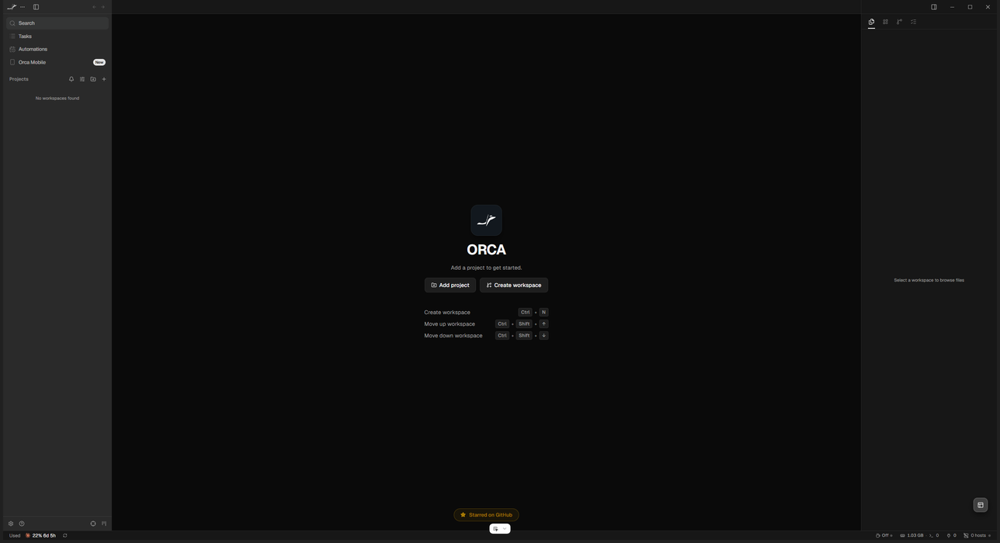

# Hawl Workstation

The free, open-source desktop workstation for [Hawl](https://hawl.ai): an agentic IDE where you start and run whole projects, with your agents, your team's agents, jobs, approvals and a live map built in, and Hawl sign-in.

*Design art from the Hawl design set (transparent PNG). It is a design reference, not a screenshot of this app.*

**Status 2026-10-19: early.** This repository is a thin fork of Orca with design and planning documents added. The Hawl features below are not built. Today the app you get from this source is stock Orca (a terminal workspace for running coding agents in git worktrees), still named Orca. This is what `pnpm dev` on this tree shows today, captured 2026-10-19 on Windows:

There is no download yet (release is milestone M7), and no badges: nothing is published.

## What it will do

Each item is a numbered line in [SPEC-MAP.md](SPEC-MAP.md) (S4 to S50) with the screen that shows it and how it will be proven.

- **Your yard.** One yard per person: every agent on every machine, each project folder shown as a station, the same yard plugged into more than one site with its own menu and jobs per site (S4, S5).
- **Jobs between yards.** Open a job; the Dispatcher routes it to the right yard's foreman and agent, and the job drawer shows every hop and why (S9, S13, S14, S19, S20).
- **Proof of delivery.** Work is "running" only once an agent claims it, and "done" comes with a receipt: CI result, device test, requester sign-off, each shown or marked "not checked" (S16, S31 to S35).
- **Approvals on your phone.** Agents ask before a risky action or ask you a question; you answer from the desktop or the phone, and a push to main waits for an approval tied to that exact commit (S39 to S41).
- **A foreman for your yard.** You register one of your own agents as the foreman; the workstation guides setup and warns when there is none or it is offline (S11, S12, S43, S44).
- **A live map.** The Dispatcher hub, yards as factories, jobs as crates by state, with a plain list view (S45 to S47).

Today none of these exist; the first milestones are the rebrand (M0) and Hawl sign-in (M1).

## Built on Orca

Hawl Workstation is built on [Orca](https://github.com/stablyai/orca) by Stably AI / Lovecast Inc., released under the MIT license. We do not hide that. Orca provides the shell: terminals, git worktrees, the agent-status hooks, the plugin host and the mobile companion. Hawl adds its own features, theme, graphics and icons on top, kept in `src/hawl/`, `hawl-mobile/` and `hawl-plugin/`. Edits to Orca's own files are small hooks, each one row in [FORK-HOOKS.md](FORK-HOOKS.md).

Orca's original copyright and license stay in [LICENSE](LICENSE). The weekly routine for pulling Orca's changes is in [UPSTREAM.md](UPSTREAM.md).

## Install

There is no Hawl download yet; release is milestone M7. Until then you can run it from source (below) or build a Windows installer yourself with `pnpm build:win` (script exists in `package.json`; not run for this fork). The stock Orca app is a separate program and uses its own data folder.

## Run it from source (seen on Windows only)

Seen on 2026-10-19 on Windows Server 2025, Node v24.20.0, pnpm 12.14.0, in a fresh git worktree of this repository: `pnpm install` exit 0 (it ran `node-gyp rebuild` for native modules, so Windows needs Python and C++ build tools; Python 3.14.7 was present, the C++ toolset was not checked), then `pnpm dev` with `ORCA_DEV_USER_DATA_PATH` set to an empty folder built the main process and preload, started the renderer dev server, launched Electron and showed the window in the screenshot above (title "Orca"). macOS and Linux were not run. `pnpm test` was not run (it needs Bun, not installed on that machine). The same tree does not yet show anything Hawl: no Hawl code is built.

1. Install Node 24 (`package.json` `engines`) and pnpm 12.14.0 (`packageManager`). Bun is needed only for `pnpm test`, version in [config/.bun-version](config/.bun-version). Details: [.github/CONTRIBUTING.md](.github/CONTRIBUTING.md), "Local Setup".
2. In the repository folder run `pnpm install` and wait for it to finish with exit 0. Do not skip it or stop it early.
3. Run `pnpm dev`. It uses its own user-data folder (`%APPDATA%\orca-dev` on Windows, per `config/scripts/run-electron-vite-dev.mjs:434-451`).
4. To keep a dev copy away from an installed Orca or another dev copy, set `ORCA_DEV_USER_DATA_PATH` to a separate folder first. In PowerShell: `$env:ORCA_DEV_USER_DATA_PATH='C:\dev\my-userdata'`. Never run two copies on the same user-data folder.

If `pnpm dev` stops at `ensure:electron-runtime` with `ENOENT ... node_modules\electron\package.json` or `Cannot find package '@electron/rebuild'`, the install did not complete in this folder (seen on a checkout whose `node_modules` was incomplete). Run `pnpm install` again in that folder, check it ends with exit 0, then run `pnpm dev`. That recovery was not reproduced on the failing checkout.

Other commands (from `package.json`): `pnpm typecheck` type-checks all projects, `pnpm lint` runs the lint gates, `node hawl-tools/check-docs.mjs` checks the documents here against the code.

## Where things are

| Document | What it holds |
|---|---|
| [PROJECT.md](PROJECT.md) | What this is, status, decisions |
| [ARCHITECTURE.md](ARCHITECTURE.md) | Shell, the list of screens, the seams in Orca's code, relay events, foreman, phone |
| [SPEC-MAP.md](SPEC-MAP.md) | Every Hawl behavior line (S4 to S50): which screen shows it, where the data comes from, how it is proven, when it is built |
| [FORK-HOOKS.md](FORK-HOOKS.md) | Every planned edit to an Orca file, with its anchor |
| [UPSTREAM.md](UPSTREAM.md) | Merging Orca's updates |
| [CONTRIBUTING.md](CONTRIBUTING.md) | Working in this fork |

## License

MIT, see [LICENSE](LICENSE).
